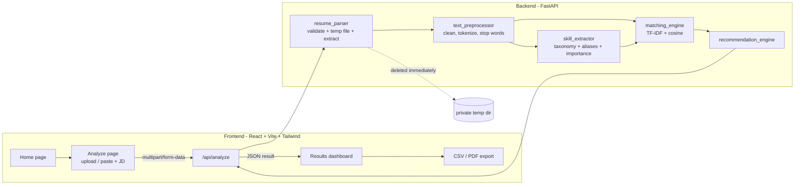

# AI Resume Matcher Using Natural Language Processing

A full-stack NLP application that compares a resume with a job description, extracts skills, computes a transparent compatibility score (TF-IDF cosine similarity + skill coverage), identifies missing skills and generates improvement suggestions.

> **Important:** the match score measures *text and skill similarity*. It is **not** a probability of being shortlisted or hired, and it does not measure candidate quality.

It runs fully offline: no paid AI APIs, no API keys, no database.

---

## Table of contents

1. [Problem statement](#problem-statement)
2. [Objectives](#objectives)
3. [Features](#features)
4. [System architecture](#system-architecture)
5. [NLP methodology and formulas](#nlp-methodology-and-formulas)
6. [Technology stack](#technology-stack)
7. [Folder structure](#folder-structure)
8. [Installation](#installation)
9. [Running the application](#running-the-application)
10. [API usage](#api-usage)
11. [Testing](#testing)
12. [Limitations](#limitations)
13. [Privacy and ethical considerations](#privacy-and-ethical-considerations)
14. [Future enhancements](#future-enhancements)
15. [Screenshots](#screenshots)

---

## Problem statement

Job seekers often send the same resume to many roles without knowing how well it matches each job description. Recruiters and applicant tracking systems scan for specific skills and vocabulary, so a qualified candidate may be overlooked because the resume does not mention them explicitly. Manual comparison is slow and subjective.

## Objectives

- Extract text reliably from PDF and DOCX resumes, or accept pasted text.
- Preprocess text without destroying technical terms such as C++, C#, .NET or Node.js.
- Extract skills with a configurable taxonomy and alias normalization.
- Measure document similarity with TF-IDF vectors and cosine similarity.
- Compute skill coverage and a transparent, weighted overall score.
- Present matched, missing and additional skills plus honest, actionable recommendations.
- Process resumes privately: validate inputs, keep nothing on disk, log nothing sensitive.

## Features

| Area | What is implemented |
|---|---|
| Resume input | PDF / DOCX upload (drag-and-drop, replace, remove), or pasted text; client- and server-side validation (type, 5 MB size, file signature) |
| Job description | Large text area with word counter and minimum-length validation; 4 clearly labelled **sample** job descriptions |
| Text extraction | PyMuPDF for PDF, python-docx for DOCX (paragraphs and tables); clear errors for corrupted, password-protected, empty or scanned PDFs |
| Preprocessing | Unicode NFKC, hyphenation repair, removal of bullets/URLs/emails/phone numbers, technical-term-preserving tokenizer, stop-word removal |
| Skill extraction | 117 skills in 8 categories, alias normalization, case-sensitive handling of ambiguous names (C, R, Go), longest-match overlap resolution, inferred skills (PostgreSQL → SQL), "X or Y" alternatives |
| Importance detection | JD skills labelled *required / mentioned / preferred* from section headers and wording |
| Matching | TF-IDF + cosine similarity, skill coverage, weighted overall score, match level |
| Results dashboard | Score ring, component cards, the score calculation written out, skill chips, category chart, TF-IDF keyword table, prioritized recommendations, scoring method explanation |
| Export | CSV and PDF reports built from the same data the dashboard displays |
| Reset | "New analysis" clears all inputs and results |
| API | `POST /api/analyze`, `GET /api/health`, Swagger UI at `/docs` |
| Tests | 110 backend tests (pytest) + 13 frontend tests (Vitest) |

## System architecture



Responsibilities are separated: the UI only collects input and renders results; `analyzer.py` orchestrates the pipeline; each NLP step is an independent, separately tested module. More detail: [`docs/methodology.md`](docs/methodology.md).

## NLP methodology and formulas

1. **Text extraction:** PyMuPDF reads each PDF page's text layer; python-docx reads paragraphs and table cells. Scanned PDFs have no text layer and are rejected with an explanation (OCR is not implemented).
2. **Preprocessing:** NFKC normalization, re-joining `develop-\nment`, removing bullets, URLs, e-mails and phone numbers, collapsing whitespace. Case is kept for skill detection (to tell *Go* the language from *go* the verb) and lowercased for TF-IDF.
3. **Tokenization:** custom regex `(?:(?<![\w])\.)?[a-z0-9][a-z0-9_]*(?:[./][a-z0-9_]+)*[+#]*` keeps `c++`, `c#`, `.net`, `node.js`, `ci/cd` as single tokens. Stop words are scikit-learn's English list plus a small list of generic job-post words ("experience", "responsibilities", "develop"...).
4. **Skill extraction:** each alias becomes a regex with *technical-term boundaries* (no letter, digit, `+`, `#` or `.` on either side), so `Java` ≠ `JavaScript`, `C` ≠ `C++`, and `JS` inside `Node.js` is not JavaScript. Overlaps are resolved longest-first.
5. **Skill canonicalization for TF-IDF:** every skill mention is replaced by one token (`JS`, `JavaScript` → `skill_javascript`; `machine learning` → `skill_machine_learning`), so aliases and multi-word skills count as the same term.
6. **TF-IDF + cosine similarity:** `TfidfVectorizer(analyzer=custom, sublinear_tf=True, smooth_idf=True, norm="l2")` fitted on the two documents together.
7. **Scoring and recommendations:** described below.

**Formulas:**

```
tf-idf(t, d)          = (1 + ln tf(t, d)) × (ln((1 + n) / (1 + df(t))) + 1)      n = 2 documents
cosine(A, B)          = (A · B) / (‖A‖ ‖B‖)

TF-IDF Similarity (%) = cosine(resume, job description) × 100
Skill Coverage (%)    = |matched JD skills| / |unique JD skills| × 100
Overall Match Score   = 0.60 × TF-IDF Similarity + 0.40 × Skill Coverage
```

- **Zero denominator:** if no taxonomy skills are found in the JD, `skill_coverage` is `null` and the overall score is the TF-IDF similarity alone. The response's `scoring_method.overall_formula` states this explicitly.
- **Alternatives:** in "FastAPI, Django or Flask", the unused options are not counted as required when the resume has one of them (they appear under `alternative_skills`). A skill that is also demanded on its own elsewhere stays required.
- **Weights rationale:** TF-IDF uses the whole document (responsibilities, domain vocabulary), so it gets the larger share. Skill coverage rewards explicit requirements but only sees taxonomy skills. The weights are heuristic and configurable (`TFIDF_WEIGHT`, `SKILL_WEIGHT` environment variables); they are not validated hiring weights.
- **Match levels:** Strong ≥ 60, Good ≥ 40, Partial ≥ 20, Low < 20. These are calibrated to the observed range of TF-IDF cosine values (related real documents typically score 20–45 %), not to hiring outcomes.
- **Semantic embeddings:** not used. Keeping matching lexical makes it deterministic, explainable and offline.

**Results on the bundled fictional samples** (generated by the actual code):

| Resume ↓ / Job → | Python Backend | Data Analyst | ML Engineer | Frontend |
|---|---|---|---|---|
| Python developer | **43.0 Good** | 6.6 Low | 15.3 Low | 19.1 Low |
| Data analyst | 8.5 Low | **46.1 Good** | 11.1 Low | 0.0 Low |
| Chef (unrelated) | 0.0 Low | 0.5 Low | 0.0 Low | 0.0 Low |

## Technology stack

| Layer | Technology |
|---|---|
| Frontend | React 18 (JavaScript/JSX), Vite 5, Tailwind CSS 3, React Router 6, Lucide React, Recharts, jsPDF + jspdf-autotable |
| Backend | Python 3.12 (3.11+ works), FastAPI, Uvicorn, Pydantic 2, python-multipart |
| NLP / ML | scikit-learn (TF-IDF, cosine similarity, stop words), NumPy, regular expressions |
| Documents | PyMuPDF (PDF), python-docx (DOCX) |
| Testing | pytest, FastAPI TestClient (HTTPX), Vitest |

NLTK and spaCy were deliberately not used: their stop-word and model data need separate downloads, and scikit-learn's built-in list plus the custom tokenizer covers this project's needs while keeping the setup offline.

## Folder structure

```
AI-Resume-Matcher/
├── backend/
│   ├── app/
│   │   ├── main.py                  # FastAPI app, CORS
│   │   ├── config.py                # weights, limits (env-overridable)
│   │   ├── api/routes.py            # /api/health, /api/analyze
│   │   ├── schemas/analysis.py      # Pydantic response models
│   │   ├── data/skills.json         # skill taxonomy (117 skills, 8 categories)
│   │   └── services/
│   │       ├── resume_parser.py         # validation + PDF/DOCX extraction
│   │       ├── text_preprocessor.py     # cleaning, tokenizer, stop words
│   │       ├── skill_extractor.py       # alias matching, importance, alternatives
│   │       ├── matching_engine.py       # TF-IDF, cosine, coverage, score
│   │       ├── recommendation_engine.py # rule-based suggestions
│   │       └── analyzer.py              # pipeline orchestration
│   ├── scripts/generate_sample_documents.py
│   ├── tests/                       # 110 pytest tests
│   ├── pytest.ini
│   └── requirements.txt
├── frontend/
│   ├── src/
│   │   ├── components/   # Layout, FileDropzone, Feedback, ResultWidgets
│   │   ├── pages/        # Home, Analyze, Results, Methodology
│   │   ├── services/api.js
│   │   ├── utils/        # validation, export (CSV/PDF), formatting
│   │   ├── data/sampleJobs.js
│   │   ├── __tests__/    # Vitest tests
│   │   ├── App.jsx
│   │   └── main.jsx
│   ├── package.json
│   └── vite.config.js
├── sample_data/
│   ├── job_descriptions/  # 4 fictional sample JDs
│   └── resumes/           # 3 fictional resumes as .txt, .pdf, .docx
├── docs/
│   ├── methodology.md
│   └── screenshots/
├── start.sh
└── README.md
```

## Installation

Prerequisites: **Python 3.11+** and **Node.js 18+**.

```bash
# Backend
cd backend
python3.12 -m venv .venv            # or python3.11
source .venv/bin/activate           # Windows: .venv\Scripts\activate
pip install -r requirements.txt

# Frontend
cd ../frontend
npm install
```

Optionally, regenerate the sample PDF/DOCX resumes with `cd backend && python scripts/generate_sample_documents.py`.

## Running the application

**Option A, both at once:**

```bash
./start.sh                       # backend :8000, frontend :5173
BACKEND_PORT=8010 ./start.sh     # if port 8000 is already used
```

**Option B, two terminals:**

```bash
# Terminal 1
cd backend && source .venv/bin/activate
uvicorn app.main:app --reload --port 8000

# Terminal 2
cd frontend
npm run dev                      # http://localhost:5173
# If the backend runs on another port:
BACKEND_URL=http://127.0.0.1:8010 npm run dev
```

- App: http://localhost:5173
- API docs (Swagger UI): http://127.0.0.1:8000/docs
- Health: http://127.0.0.1:8000/api/health

The Vite dev server proxies `/api` to the backend, so no CORS or URL configuration is needed.

**Optional environment variables** (none are required):

| Variable | Default | Purpose |
|---|---|---|
| `TFIDF_WEIGHT` / `SKILL_WEIGHT` | `0.60` / `0.40` | Score weights (normalized to sum to 1) |
| `MAX_FILE_SIZE_MB` | `5` | Upload limit |
| `CORS_ORIGINS` | `http://localhost:5173,http://127.0.0.1:5173` | Allowed browser origins |
| `BACKEND_URL` (frontend) | `http://127.0.0.1:8000` | Vite proxy target |
| `VITE_API_URL` (frontend) | empty | Call a backend on another origin directly |

### Ports

| Service | Default | Notes |
|---|---|---|
| Frontend (Vite) | `5173` | Proxies `/api` to `BACKEND_URL` |
| Backend (FastAPI) | `8000` | Any free port works, e.g. `8010` when 8000 is taken by another app: run `BACKEND_PORT=8010 ./start.sh`, or start uvicorn with `--port 8010` and the frontend with `BACKEND_URL=http://127.0.0.1:8010 npm run dev` |

### Using the sample data

Everything in `sample_data/` is fictional and safe to share:

- **Job descriptions:** `sample_data/job_descriptions/` holds 4 JDs (Python Backend, Data Analyst, ML Engineer, Frontend). They appear in the Analyze page's "Try a sample job description" menu, labelled `SAMPLE:`.
- **Resumes:** `sample_data/resumes/` holds 3 resumes (Python developer, data analyst, and an unrelated chef as a negative control), each as `.txt`, `.pdf` and `.docx`. Upload the PDF/DOCX to test file parsing, or use "Load sample resume" in the *Paste text* tab.
- **Regenerating:** the PDF/DOCX files are generated from the `.txt` files with `python backend/scripts/generate_sample_documents.py`.

## API usage

### `GET /api/health`

```bash
curl http://127.0.0.1:8000/api/health
# {"status":"ok","version":"1.0.0","skills_in_taxonomy":117}
```

### `POST /api/analyze` (multipart/form-data)

| Field | Required | Description |
|---|---|---|
| `job_description` | yes | Job description text (≥ 10 words / 50 chars) |
| `resume_file` | one of | PDF or DOCX, ≤ 5 MB |
| `resume_text` | one of | Pasted resume text (≥ 50 chars) |

```bash
# File upload
curl -X POST http://127.0.0.1:8000/api/analyze \
  -F "resume_file=@sample_data/resumes/sample_resume_python_developer.pdf" \
  -F "job_description=<sample_data/job_descriptions/python_backend_developer.txt"

# Pasted text
curl -X POST http://127.0.0.1:8000/api/analyze \
  -F "resume_text=<sample_data/resumes/sample_resume_data_analyst.txt" \
  -F "job_description=<sample_data/job_descriptions/data_analyst.txt"
```

**Status codes:** `200` success · `400` no resume, or both file and text · `413` file too large · `415` unsupported file type · `422` corrupted / password-protected / scanned / empty document, or text too short.

**Sample output** (abridged real response for the sample Python resume vs. the Python Backend JD):

```json
{
  "overall_match_score": 43.0,
  "match_level": "Good match",
  "tfidf_similarity": 29.5,
  "skill_coverage": 63.2,
  "matched_skills": [
    { "name": "PostgreSQL", "category": "Databases", "implied": false, "implied_by": [], "importance": "required" }
  ],
  "missing_skills": [
    { "name": "Communication", "category": "Soft Skills", "importance": "required", "job_mentions": 1, "priority": "high" }
  ],
  "additional_skills": [{ "name": "Linux", "category": "Cloud & DevOps" }],
  "alternative_skills": [{ "name": "Django", "category": "Web Development", "satisfied_by": ["FastAPI", "Flask"] }],
  "job_skill_count": 19,
  "resume_skill_count": 25,
  "category_breakdown": [{ "category": "Cloud & DevOps", "required": 5, "matched": 1 }],
  "extracted_resume_text_length": 1271,
  "resume_word_count": 169,
  "job_description_word_count": 134,
  "job_description_keywords": [{ "term": "Python", "weight": 0.2523, "in_resume": true, "is_skill": true }],
  "recommendations": [
    { "id": 1, "priority": "high", "category": "Missing skills", "title": "Address 2 high-priority skill gaps", "detail": "...", "skills": ["Communication", "Problem Solving"] }
  ],
  "scoring_method": {
    "overall_formula": "Overall Match Score = 0.60 x TF-IDF Similarity + 0.40 x Skill Coverage",
    "tfidf_formula": "...", "skill_coverage_formula": "...",
    "weights": { "tfidf": 0.6, "skill_coverage": 0.4 },
    "weights_rationale": "...", "tfidf_settings": { "...": "..." },
    "semantic_embeddings": "Not used. Matching is lexical (keywords and TF-IDF) only.",
    "disclaimer": "This score measures text and skill similarity ... It is not a probability of being shortlisted or hired ..."
  },
  "warnings": [],
  "input_source": { "type": "file", "filename": "sample_resume_python_developer.pdf", "size_bytes": 5948 }
}
```

Check: 0.60 × 29.5 + 0.40 × 63.2 = 17.70 + 25.28 = 42.98 → **43.0**.

## Testing

```bash
cd backend && source .venv/bin/activate && pytest -v     # 110 tests
cd frontend && npm test                                   # 13 tests
```

All tests are deterministic and offline. PDF/DOCX fixtures are generated at test time. The suite covers:

- **Parsing:** PDF and DOCX parsing, including tables; unsupported, empty, oversized, renamed, corrupted, truncated, legacy `.doc` and scanned documents.
- **Text handling:** preprocessing and the tokenizer.
- **Skills:** aliases, phrase matching, false-positive guards (C vs C++, Java vs JavaScript, *go*, *excel*, R&D), importance detection and alternatives.
- **Scoring:** the skill coverage formula, including a zero denominator; TF-IDF/cosine edge cases (identical, disjoint, empty vocabulary); score bounds.
- **Analysis quality:** relevant vs. unrelated resumes; internal consistency of the results; recommendations that never fabricate.
- **API:** status codes and validation; PDF and pasted-text results agree; no resume text appears in logs.
- **Temp files:** cleanup after both success and failure.
- **Frontend:** validation rules, CSV escaping, and export values matching the displayed values.

## Limitations

- **Lexical matching only.** Synonyms, paraphrases and skills outside the taxonomy can be missed ("built data pipelines" is understood, "wrangled datasets" is not). Context and negation are not understood: "no experience with Java" still counts as Java.
- **TF-IDF similarity is not candidate quality or hiring probability.** It measures shared vocabulary only.
- **Two-document IDF.** Fitting on just the resume and the JD gives a narrow IDF range, and terms in both documents are slightly down-weighted. Absolute similarity values are therefore modest (typically 20–45 % for good matches).
- **Taxonomy-dependent coverage.** It is a hand-curated list of 117 skills; extend `backend/app/data/skills.json` for other domains.
- **Importance heuristics.** Required/preferred labels come from keywords and headings and can be wrong for unusual layouts.
- **No OCR.** Scanned or image-only PDFs are rejected. Legacy `.doc` is not supported.
- **Short ambiguous names.** C, R and Go are matched case-sensitively; "Go" at the start of an ordinary sentence could still be misread.
- **Layout.** Complex multi-column PDFs may extract in an unusual reading order (this affects TF-IDF very little, since word order is ignored).

## Privacy and ethical considerations

- **No persistence.** Uploads are written to a private (0700) temporary directory under a generated name and deleted in a `finally` block. There is no database, results live only in browser memory (not localStorage), and the reset button clears them.
- **No sensitive logging.** Only metadata (status, type, score) is logged; a test verifies that resume text never reaches the logs. E-mails, phone numbers and URLs are stripped before analysis.
- **Untrusted input.** Files are checked by extension, size and magic bytes and parsed only as text. Macros and embedded content are never executed. Size limits are enforced on both client and server.
- **No third parties.** No paid or external AI APIs, no telemetry, and no secrets in source control.
- **Honest output.** Recommendations always make keyword suggestions conditional on genuine experience and never fabricate qualifications. The UI and exports state that the score is not a hiring probability.
- **Fair use.** Keyword-based screening can disadvantage candidates who describe the same skills in different words. This tool is meant to help candidates improve their resumes, not to make automated rejection decisions about people.

## Future enhancements

- Optional semantic similarity with sentence embeddings (e.g. `all-MiniLM-L6-v2`), reported as a separate, documented component.
- OCR for scanned PDFs (Tesseract).
- Negation and context handling ("no experience with...") and section-aware parsing (Education, Experience).
- Lemmatization and a larger, domain-specific taxonomy (healthcare, finance, mechanical).
- Experience-level extraction (years of experience, degree requirements).
- Comparing one resume with several job descriptions side by side.
- Evaluating the weights against a labelled dataset of resume–job pairs.

## Screenshots

> Placeholders: capture these from the running app and save them in `docs/screenshots/`.

| Screen | File |
|---|---|
| Landing page | `docs/screenshots/01-home.png` |
| Analyze page with a file selected and a sample JD | `docs/screenshots/02-analyze.png` |
| Validation error (unsupported file / short JD) | `docs/screenshots/03-validation.png` |
| Results: score overview | `docs/screenshots/04-results-score.png` |
| Results: skills, chart and keywords | `docs/screenshots/05-results-skills.png` |
| Results: recommendations and scoring method | `docs/screenshots/06-recommendations.png` |
| Methodology page | `docs/screenshots/07-methodology.png` |
| Swagger API docs | `docs/screenshots/08-api-docs.png` |
| Exported PDF report | `docs/screenshots/09-export-pdf.png` |
| Test run output | `docs/screenshots/10-tests.png` |

---

*All names, companies and job descriptions in `sample_data/` are fictional and exist only for demonstration.*
