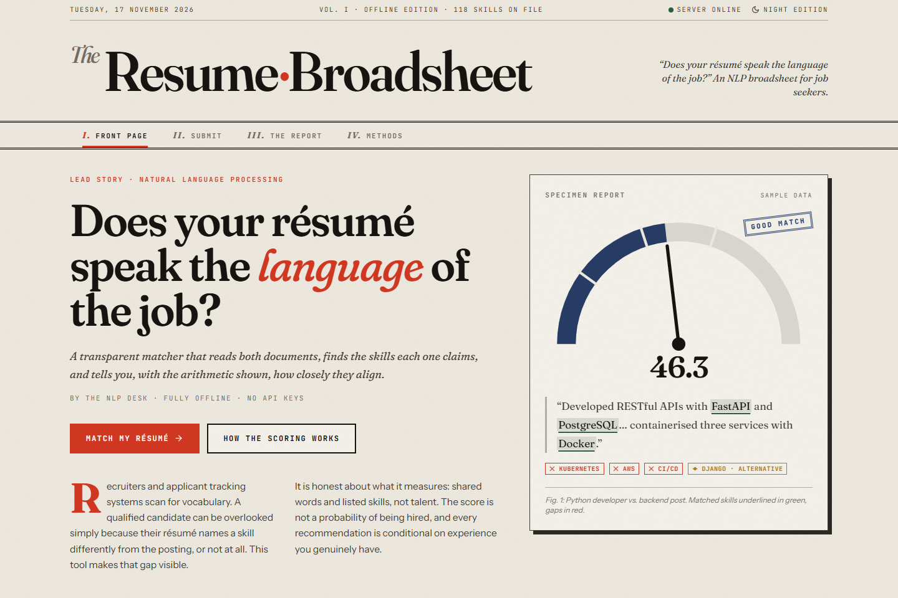
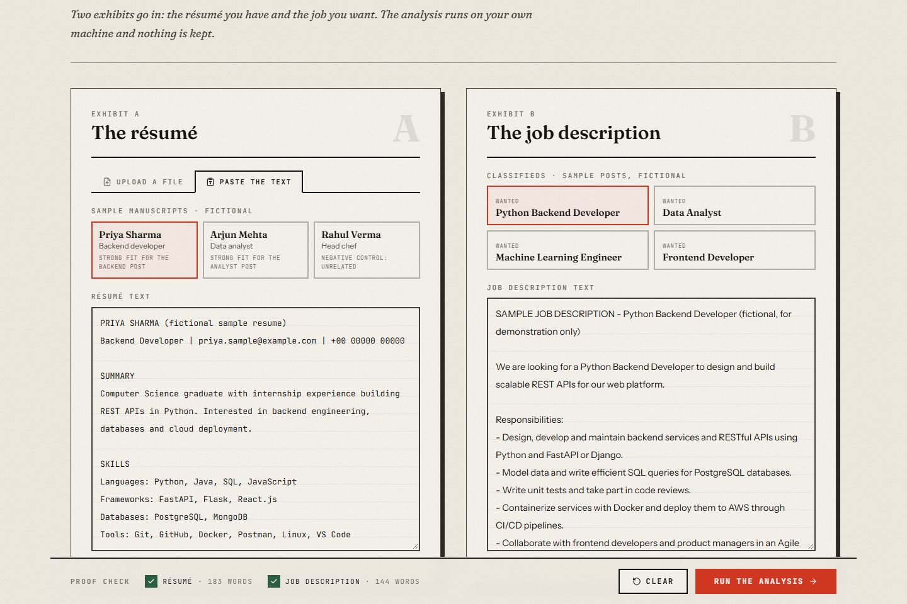
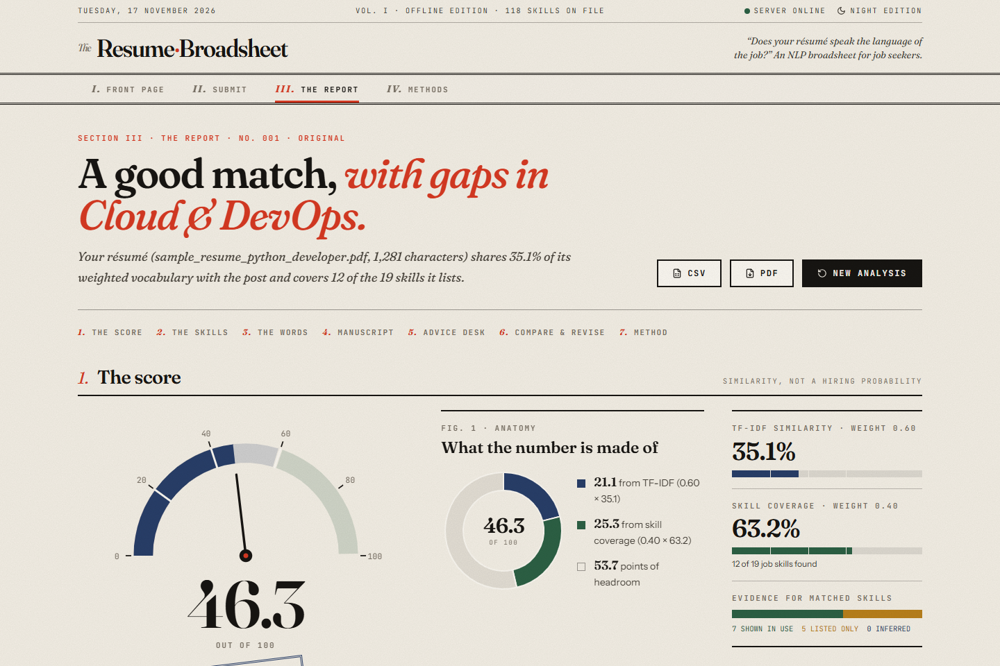
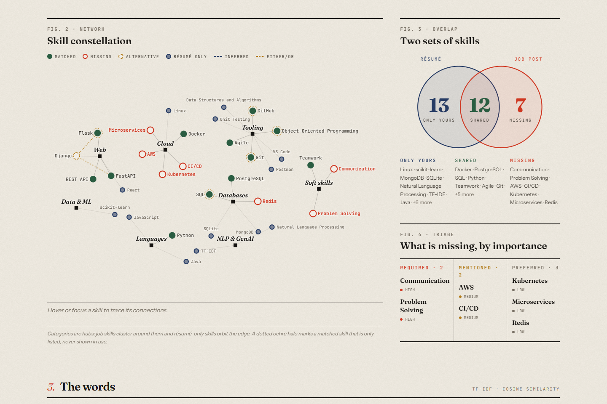
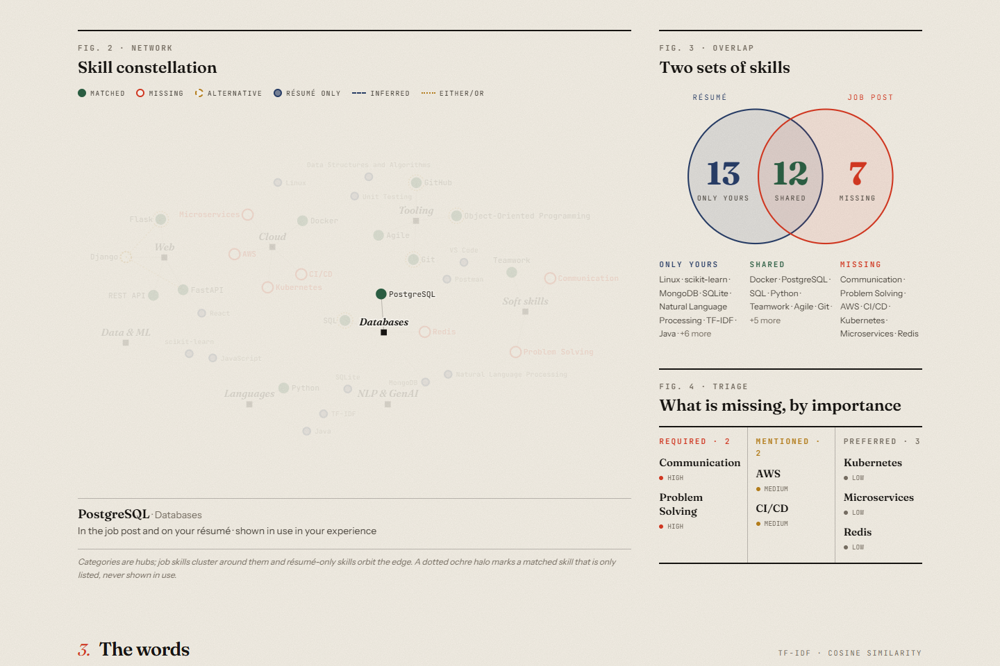
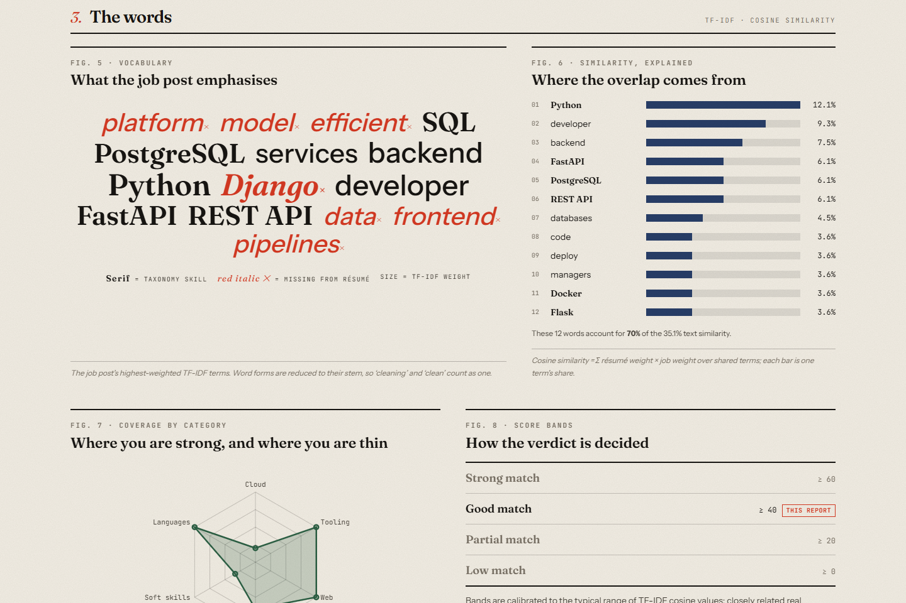
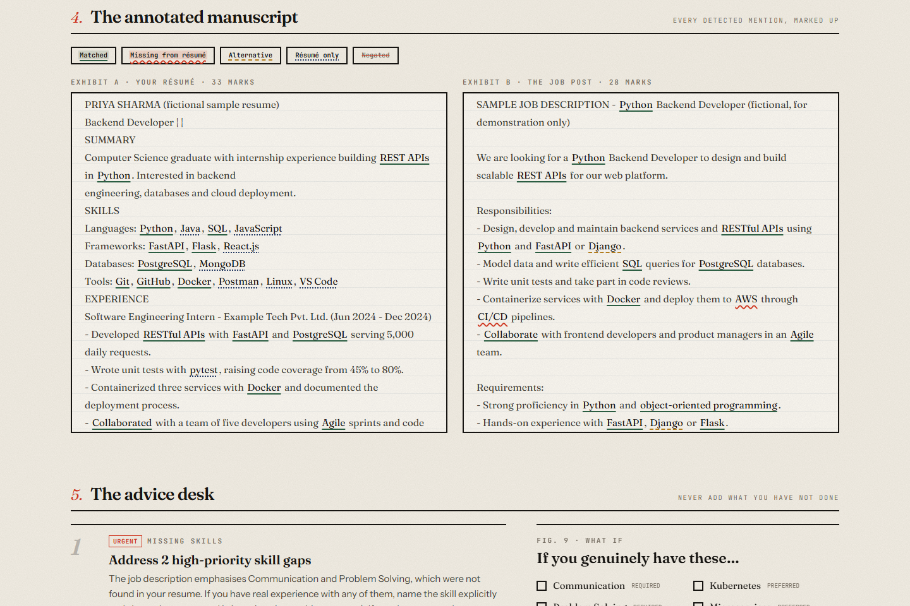
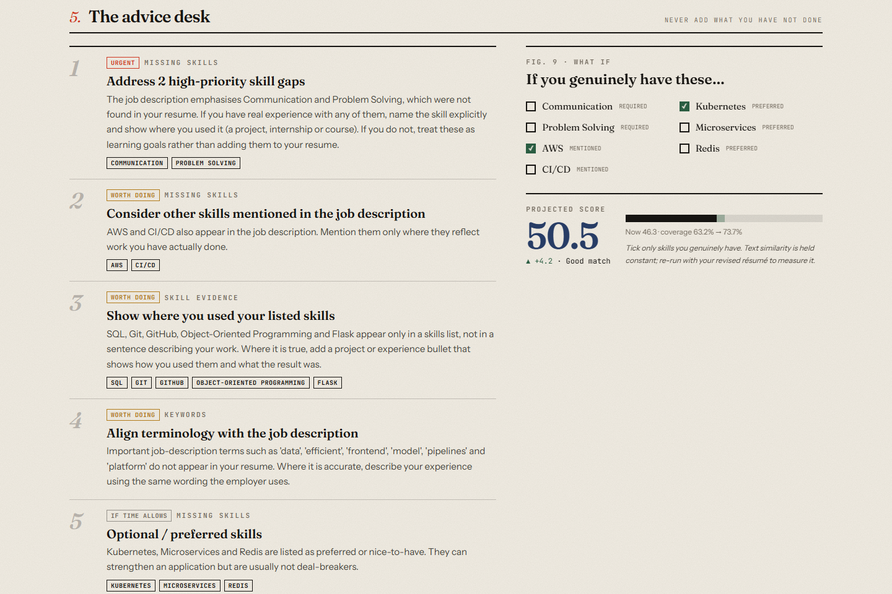
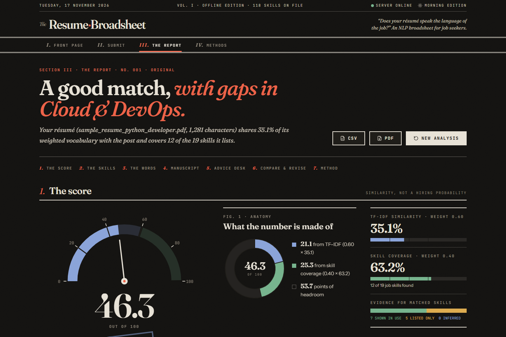
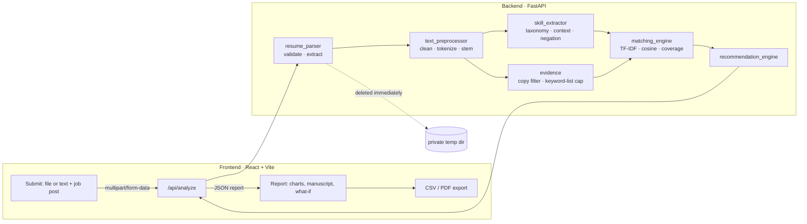

<div align="center">

# The Resume · Broadsheet

**An offline NLP résumé matcher, set in type like a newspaper.**

Compare a résumé with a job description and get a transparent match score: the arithmetic shown, the skill gaps mapped, both documents annotated, and honest advice that never invents experience.

[](https://github.com/finding-archit/resume-broadsheet/actions/workflows/ci.yml)




</div>

> **What the score is, and what it is not.** It measures text and skill similarity between two documents. It is **not** a probability of being shortlisted or hired, and it does not measure candidate quality.

---

## Contents

- [Why](#why)
- [Features](#features)
- [A tour of the report](#a-tour-of-the-report)
- [Quick start](#quick-start)
- [How it works](#how-it-works)
- [API](#api)
- [Project structure](#project-structure)
- [Testing and CI](#testing-and-ci)
- [Configuration](#configuration)
- [Limitations](#limitations)
- [Privacy and ethics](#privacy-and-ethics)
- [Roadmap](#roadmap)
- [Credits](#credits)

## Why

Recruiters and applicant tracking systems scan for vocabulary. A qualified candidate can be overlooked because their résumé names a skill differently from the posting, or not at all, and comparing by hand is slow and subjective. The Resume Broadsheet makes that gap visible, explains every number it produces, and refuses to reward keyword stuffing.

Everything runs on your machine: no paid AI APIs, no API keys, no database, no telemetry.

## Features

| | |
|---|---|
| **Input** | PDF or DOCX upload (drag and drop) or pasted text; 3 fictional sample résumés and 4 sample job posts; validation of type, size, file signature and minimum length on both client and server |
| **Extraction** | PyMuPDF (PDF) and python-docx (DOCX, including tables); clear errors for corrupted, password-protected, empty or scanned files |
| **Skills** | 118-skill taxonomy in 8 categories with aliases; technical-term boundaries (Java ≠ JavaScript, C ≠ C++); context checks for ambiguous words (Swift, Express, Go, Spark, Excel); name-initial guard; negation ("no experience with Kubernetes"); inferred skills (PostgreSQL → SQL); "X or Y" alternatives; required / mentioned / preferred importance |
| **Matching** | TF-IDF with Snowball stemming and canonical skill tokens, cosine similarity, skill coverage, weighted overall score, per-term breakdown of the similarity |
| **Honesty** | Each skill is *shown in use*, *listed only* or *inferred*; lines copied from the job post are ignored; a bare keyword list is capped below "Good match" |
| **Report** | Animated gauge and verdict stamp, score-anatomy donut, d3-force skill constellation, Venn diagram, triage board, keyword word-wall, similarity breakdown, category radar, annotated side-by-side manuscript, what-if simulator, multi-job comparison heatmap, edit-and-re-run with revision history |
| **Design** | Editorial "broadsheet" layout with light (morning) and dark (night) editions; Fraunces, Instrument Sans and JetBrains Mono bundled locally; responsive and keyboard accessible; honours reduced motion |
| **Export** | CSV and a typeset PDF, built from the same data the report shows |
| **API** | `POST /api/analyze`, `GET /api/config`, `GET /api/health`, Swagger UI at `/docs` |
| **Quality** | 189 backend tests (pytest) and 20 frontend tests (Vitest), run on every push by GitHub Actions |

## A tour of the report

<table>
<tr>
<td width="50%"><br><sub><b>Submit.</b> Two exhibits, sample manuscripts and classifieds, and a live proof check.</sub></td>
<td width="50%"><br><sub><b>The score.</b> A generated headline, the gauge, what the number is made of, and the evidence behind matched skills.</sub></td>
</tr>
<tr>
<td><br><sub><b>The skills.</b> A force-directed constellation grouped by category, the résumé/job overlap, and missing skills triaged by importance.</sub></td>
<td><br><sub><b>Trace a skill.</b> Hover or focus any node to isolate its connections and read its evidence.</sub></td>
</tr>
<tr>
<td><br><sub><b>The words.</b> What the job post emphasises, and exactly which shared terms make up the similarity.</sub></td>
<td><br><sub><b>The annotated manuscript.</b> Every detected mention, marked up in both documents, with filters.</sub></td>
</tr>
<tr>
<td><br><sub><b>The advice desk.</b> Prioritised, conditional recommendations and a what-if projection.</sub></td>
<td><br><sub><b>Night edition.</b> The same report in the dark theme.</sub></td>
</tr>
</table>

## Quick start

**Prerequisites:** Python 3.11 or newer (tested up to 3.14) and Node.js 18 or newer.

```bash
git clone https://github.com/finding-archit/resume-broadsheet.git
cd resume-broadsheet

# Backend
cd backend
python -m venv .venv
source .venv/bin/activate          # Windows: .venv\Scripts\activate
pip install -r requirements.txt

# Frontend
cd ../frontend
npm install
```

**Run both servers at once:**

```bash
./start.sh                         # macOS / Linux
```

```powershell
.\start.ps1                        # Windows PowerShell
```

Then open **http://127.0.0.1:5173**. The API runs on http://127.0.0.1:8000 (Swagger UI at `/docs`).

<details>
<summary><b>Run the two servers separately, or on another port</b></summary>

```bash
# Terminal 1: backend
cd backend && source .venv/bin/activate      # Windows: .venv\Scripts\activate
uvicorn app.main:app --reload --port 8000

# Terminal 2: frontend (proxies /api to the backend)
cd frontend
npm run dev
```

If port 8000 is taken, start the backend on another port and point the frontend at it:

```bash
BACKEND_PORT=8010 ./start.sh                 # or: .\start.ps1 -BackendPort 8010
# or manually:
uvicorn app.main:app --port 8010
BACKEND_URL=http://127.0.0.1:8010 npm run dev
```

</details>

**Try it in ten seconds:** on the Submit page choose *Paste the text*, click the **Priya Sharma** sample and the **Python Backend Developer** post, then **Run the analysis**.

## How it works



1. **Extract.** PyMuPDF reads each PDF page's text layer; python-docx reads paragraphs and table cells. Scanned PDFs are rejected (no OCR).
2. **Clean.** Unicode NFKC, re-joined hyphenation, and removal of bullets, URLs, e-mails and phone numbers (year ranges are kept). Case is preserved so *Go* the language differs from *go* the verb.
3. **Find skills.** Aliases become regular expressions with technical-term boundaries; the longest match wins; ambiguous words need technical context; negated mentions are dropped; importance comes from headings and wording.
4. **Weigh words.** Each skill mention becomes one canonical token (`JS` and `JavaScript` → `skill_javascript`); other words are stemmed; a TF-IDF vectoriser (sublinear TF, smoothed IDF, L2 norm) is fitted on the two documents.
5. **Score and advise.** Cosine similarity and skill coverage are combined; rule-based recommendations are generated from the results.

```text
TF-IDF Similarity (%) = cosine(résumé, job post) × 100        cosine = Σ rᵢ·jᵢ (L2-normalised)
Skill Coverage (%)    = matched job skills / unique job skills × 100
Overall Match Score   = 0.60 × TF-IDF Similarity + 0.40 × Skill Coverage
```

- **No job skills found:** coverage is `null` and the overall score is the TF-IDF similarity alone.
- **Alternatives:** in "FastAPI, Django or Flask", having any one option satisfies the group.
- **Bands:** Strong ≥ 60 · Good ≥ 40 · Partial ≥ 20 · Low < 20, calibrated to typical TF-IDF cosine values (related documents usually reach 20–45 %), not to hiring outcomes.
- **Anti-gaming:** lines copied almost verbatim from the job post are removed; a résumé with fewer than 2 descriptive sentences is capped at 39.9. A bare list of the backend post's skills scores 39.9 (uncapped 75.3), and pasting the post itself as the résumé scores 5.2.

**Results on the bundled fictional samples:**

| Résumé ↓ / Job → | Python Backend | Data Analyst | ML Engineer | Frontend |
|---|---|---|---|---|
| Python developer | **46.3 Good** | 6.9 Low | 17.3 Low | 20.1 Partial |
| Data analyst | 8.9 Low | **48.1 Good** | 11.1 Low | 0.4 Low |
| Chef (unrelated) | 1.7 Low | 1.0 Low | 1.1 Low | 2.0 Low |

The full rationale, every design decision and the threats to validity are in [`docs/methodology.md`](docs/methodology.md). The app's own **Methods** page explains the same in plain language.

## API

| Method | Path | Purpose |
|---|---|---|
| `POST` | `/api/analyze` | Compare a résumé with a job description |
| `GET` | `/api/config` | Weights, score bands, input limits, taxonomy size and categories |
| `GET` | `/api/health` | Liveness, version and taxonomy size |
| `GET` | `/docs` | Interactive Swagger UI |

**`POST /api/analyze`** takes `multipart/form-data`:

| Field | Required | Description |
|---|---|---|
| `job_description` | yes | Job description text (≥ 10 words / 50 characters) |
| `resume_file` | one of | PDF or DOCX, ≤ 5 MB |
| `resume_text` | one of | Pasted résumé text (≥ 10 words / 50 characters) |

```bash
curl -X POST http://127.0.0.1:8000/api/analyze \
  -F "resume_file=@sample_data/resumes/sample_resume_python_developer.pdf" \
  -F "job_description=<sample_data/job_descriptions/python_backend_developer.txt"
```

**Status codes:** `200` success · `400` no résumé, or both file and text · `413` file or request too large · `415` unsupported file type · `422` corrupted, password-protected, scanned or empty document, or text too short.

<details>
<summary><b>Example response</b> (abridged, real values for the sample above)</summary>

```json
{
  "overall_match_score": 46.3,
  "match_level": "Good match",
  "tfidf_similarity": 35.1,
  "skill_coverage": 63.2,
  "matched_skills": [
    { "name": "PostgreSQL", "category": "Databases", "implied": false, "implied_by": [], "importance": "required", "evidence": "demonstrated" }
  ],
  "missing_skills": [
    { "name": "Communication", "category": "Soft Skills", "importance": "required", "job_mentions": 1, "priority": "high" }
  ],
  "additional_skills": [{ "name": "Linux", "category": "Cloud & DevOps", "evidence": "listed" }],
  "alternative_skills": [{ "name": "Django", "category": "Web Development", "satisfied_by": ["FastAPI", "Flask"] }],
  "job_skill_count": 19,
  "resume_skill_count": 25,
  "category_breakdown": [{ "category": "Cloud & DevOps", "required": 5, "matched": 1 }],
  "job_description_keywords": [{ "term": "Python", "weight": 0.2558, "in_resume": true, "is_skill": true }],
  "similarity_terms": [{ "term": "Python", "contribution": 0.1206, "resume_weight": 0.1655, "job_weight": 0.2558, "is_skill": true }],
  "evidence_summary": { "descriptive_segments": 9, "demonstrated": 7, "listed": 5, "inferred": 0 },
  "copied_text_removed": { "lines": 0, "characters": 0 },
  "score_cap": null,
  "documents": {
    "resume": { "text": "…cleaned text, contact details removed…", "spans": [{ "start": 144, "end": 150, "skill": "Python", "category": "Programming Languages", "status": "matched" }] },
    "job": { "text": "…", "spans": [{ "start": 25, "end": 31, "skill": "Python", "category": "Programming Languages", "status": "matched" }] }
  },
  "recommendations": [
    { "id": 1, "priority": "high", "category": "Missing skills", "title": "Address 2 high-priority skill gaps", "detail": "…", "skills": ["Communication", "Problem Solving"] }
  ],
  "scoring_method": {
    "overall_formula": "Overall Match Score = 0.60 x TF-IDF Similarity + 0.40 x Skill Coverage",
    "weights": { "tfidf": 0.6, "skill_coverage": 0.4 },
    "bands": [{ "min": 60, "label": "Strong match" }, "…"],
    "adjustments": "Keyword-list cap: …",
    "disclaimer": "This score measures text and skill similarity … It is not a probability of being shortlisted or hired …"
  },
  "warnings": [],
  "input_source": { "type": "file", "filename": "sample_resume_python_developer.pdf", "size_bytes": 5939 }
}
```

Check: 0.60 × 35.1 + 0.40 × 63.2 = 21.06 + 25.28 = 46.34 → **46.3**.

</details>

## Project structure

```text
resume-broadsheet/
├── backend/
│   ├── app/
│   │   ├── main.py                    # FastAPI app, CORS, request-size middleware
│   │   ├── middleware.py              # 413 for oversized /api/analyze bodies
│   │   ├── config.py                  # weights and limits (env-overridable)
│   │   ├── api/routes.py              # /api/health, /api/config, /api/analyze
│   │   ├── schemas/analysis.py        # Pydantic response models (drive /docs)
│   │   ├── data/skills.json           # taxonomy: 118 skills, 8 categories
│   │   └── services/
│   │       ├── resume_parser.py           # validation + PDF/DOCX extraction
│   │       ├── text_preprocessor.py       # cleaning, tokenizer, stop words, stemming
│   │       ├── skill_extractor.py         # aliases, context, negation, importance, alternatives
│   │       ├── evidence.py                # descriptive segments, copy filter, keyword-list cap
│   │       ├── matching_engine.py         # TF-IDF, cosine, term contributions, coverage, score
│   │       ├── recommendation_engine.py   # rule-based, never-fabricating advice
│   │       └── analyzer.py                # pipeline orchestration
│   ├── scripts/generate_sample_documents.py
│   ├── tests/                         # 189 pytest tests
│   ├── .env.example
│   └── requirements.txt
├── frontend/
│   ├── src/
│   │   ├── components/                # masthead, dropzone, feedback
│   │   │   └── report/                # gauge, donut, constellation, charts, manuscript, what-if, compare, revisions
│   │   ├── pages/                     # Front page, Submit, Report, Methods, 404
│   │   ├── services/                  # API client, live config + health
│   │   ├── utils/                     # validation, report maths, CSV/PDF export, theme
│   │   ├── data/sampleJobs.js         # loads ../sample_data
│   │   └── __tests__/                 # Vitest tests
│   ├── package.json
│   └── vite.config.js
├── sample_data/                       # fictional job posts and résumés (.txt, .pdf, .docx)
├── docs/
│   ├── methodology.md                 # design decisions and evaluation
│   └── screenshots/
├── .github/workflows/ci.yml           # tests + build on every push
├── start.sh / start.ps1               # run both servers
└── CHANGELOG.md · CONTRIBUTING.md
```

## Testing and CI

```bash
cd backend && python -m pytest -q        # 189 tests
cd frontend && npm test                  # 20 tests
cd frontend && npm run build             # production build
```

All tests are deterministic and offline; PDF and DOCX fixtures are generated at test time. They cover:

- **Parsing:** PDF and DOCX (including tables), and unsupported, empty, oversized, renamed, corrupted, truncated, legacy `.doc` and scanned files. Temporary files are cleaned up on success and failure.
- **Skills:** aliases and phrases; false positives (C vs C++, Java vs JavaScript, *go*, *excel*, R&D, name initials, "Swift delivery"); negation; importance; alternatives.
- **Scoring:** coverage including a zero denominator; TF-IDF edge cases; stemming; similarity contributions summing to 1; score bounds.
- **Analysis quality:** related vs unrelated résumés; internal consistency; evidence labels; the keyword-list cap and copy filter; highlight spans that point at real mentions; recommendations that never fabricate and agree in number.
- **API and performance:** status codes, `/api/config`, the request-size limit, PDF and text results agreeing, no résumé text in logs, and a 100,000-character résumé analysed in well under 5 seconds.
- **Frontend:** validation, what-if projection, highlight segmentation, score anatomy, generated headlines, CSV escaping, and exports matching the screen.

GitHub Actions runs the backend suite on Python 3.11 and 3.13 and the frontend tests and build on Node 22 for every push and pull request.

## Configuration

All settings are optional. See [`backend/.env.example`](backend/.env.example).

| Variable | Default | Purpose |
|---|---|---|
| `TFIDF_WEIGHT` / `SKILL_WEIGHT` | `0.60` / `0.40` | Score weights, normalised to sum to 1 |
| `MAX_FILE_SIZE_MB` | `5` | Upload limit (requests above it plus 1 MB get HTTP 413) |
| `CORS_ORIGINS` | `http://localhost:5173,http://127.0.0.1:5173` | Allowed browser origins |
| `BACKEND_URL` (frontend) | `http://127.0.0.1:8000` | Vite proxy target |
| `VITE_API_URL` (frontend) | empty | Call a backend on another origin directly |

The frontend reads weights, bands and limits from `/api/config`, so what it displays always matches the server.

## Limitations

- **Lexical, not semantic.** Paraphrases and skills outside the taxonomy can be missed ("built data pipelines" is understood, "wrangled datasets" is not). Simple negation is handled; subtler context is not.
- **Similarity is not quality.** TF-IDF measures shared vocabulary, not ability or hiring probability.
- **Two-document IDF.** Fitting IDF on just the résumé and the job post gives a narrow range, so good matches typically reach 20–45 % similarity.
- **Taxonomy-bound coverage.** 118 hand-curated skills; extend `backend/app/data/skills.json` for other domains.
- **Heuristic labels.** Importance and "shown in use / listed only" come from headings, wording and line shapes and can be wrong for unusual layouts.
- **No OCR.** Scanned PDFs and legacy `.doc` files are not supported.

## Privacy and ethics

- **Nothing is kept.** Uploads are read in a private (0700) temporary folder under a generated name and deleted in a `finally` block. There is no database; results live only in the browser tab's memory, and only the colour theme is saved to local storage.
- **Nothing sensitive is logged.** Only metadata (status, type, score) is logged, and a test checks that résumé text never reaches the logs. E-mails, phone numbers and URLs are stripped before analysis.
- **Untrusted input is contained.** Files are checked by extension, size and magic bytes and parsed only as text; macros and embedded content are never executed; request bodies are size-limited.
- **No third parties.** No paid or external AI APIs, no telemetry, no secrets in the repository; fonts are bundled.
- **Honest output.** Recommendations are always conditional on genuine experience, never suggest certifications or invented skills, and the UI and exports state that the score is not a hiring probability.
- **Fair use.** Keyword screening can disadvantage people who describe the same skills differently. This tool is for candidates improving their own résumés, not for automated decisions about people.

## Roadmap

- Optional semantic similarity with sentence embeddings, reported as a separate, documented component
- OCR for scanned PDFs (Tesseract)
- Section-aware parsing (Education, Experience) and richer context handling
- A background corpus for IDF so generic words are weighted against many job posts
- Larger, domain-specific taxonomies (healthcare, finance, engineering)
- Experience-level extraction (years of experience, degrees)
- Evaluating the weights against a labelled dataset of résumé–job pairs

## Credits

- The original NLP pipeline and project, **AI Resume Matcher**, was created by [Aditya Chaudhary](https://github.com/Aditya-Chaudhary-7724/AI-Resume-Matcher). Its history is preserved in this repository.
- The editorial redesign, the report visualisations, the NLP accuracy and anti-gaming work and the tooling in version 2.0 are by [finding-archit](https://github.com/finding-archit). See [`CHANGELOG.md`](CHANGELOG.md).
- Built with FastAPI, scikit-learn, PyMuPDF, python-docx, Snowball, React, Vite, Tailwind CSS, Recharts, d3-force and jsPDF. Typefaces: Fraunces, Instrument Sans and JetBrains Mono (SIL Open Font License).

All names, companies, résumés and job descriptions in `sample_data/` are fictional and exist only for demonstration.
