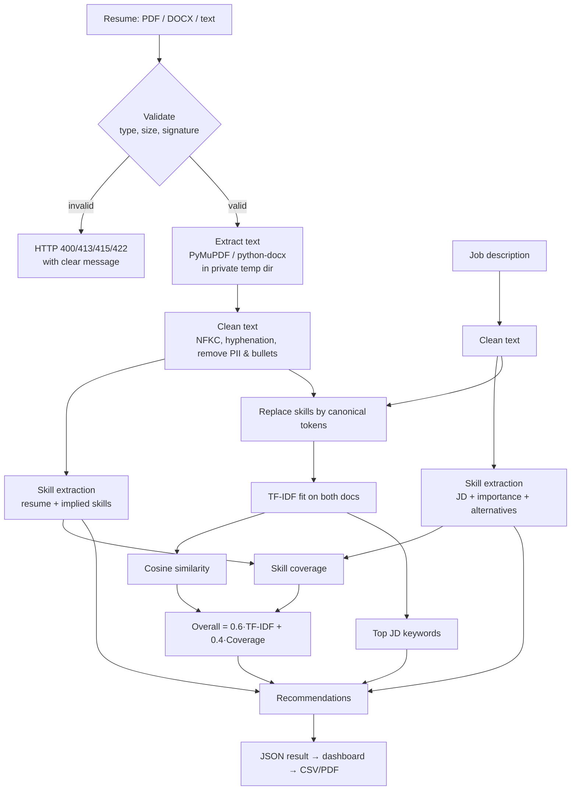

# Project Methodology: AI Resume Matcher Using NLP

This document explains the design decisions behind each stage of the pipeline, for the project report and viva.

## 1. Pipeline overview



## 2. Text extraction

| Format | Library | Notes |
|---|---|---|
| PDF | PyMuPDF (`fitz`) | `page.get_text("text")` per page; password-protected PDFs are rejected; no text layer → "scanned, OCR not supported" |
| DOCX | python-docx | Paragraphs and table cells (many templates use tables for columns); merged cells de-duplicated |
| Text | – | Used as-is |

Validation runs before parsing: extension allow-list (`.pdf`, `.docx`), size ≤ 5 MB (checked while reading the upload, so a huge file is never fully buffered) and magic bytes (`%PDF-`, `PK\x03\x04`). A renamed `.exe` or a legacy `.doc` is rejected before any parser touches it.

## 3. Preprocessing decisions

| Step | Why |
|---|---|
| NFKC normalization | Converts ligatures (`fi` → `fi`) and full-width characters produced by PDF exports |
| Re-join `word-\nword` | PDF line hyphenation would otherwise split words |
| Remove URLs, e-mails, phone numbers | Personal data and no matching signal |
| Keep original case for skill matching | Distinguishes *Go*/*R*/*C* (languages) from ordinary words |
| Custom tokenizer | Standard tokenizers turn `C++` into `c` and `.NET` into `net`; ours keeps `c++`, `c#`, `.net`, `node.js`, `ci/cd` |
| Stop words | scikit-learn English list + generic job-post words; no NLTK download needed |
| No stemming/lemmatization | Stemming damages technical terms (`pandas` → `panda`); skill canonicalization already unifies the important variants |

## 4. Skill extraction

- **Taxonomy:** `backend/app/data/skills.json` holds 117 skills in 8 categories: Programming Languages, Web Development, Databases, Data Science & ML, NLP & Generative AI, Cloud & DevOps, Software Engineering Tools, and Soft Skills.
- **Aliases:** `JS`/`ES6` → JavaScript, `ML` → Machine Learning, `NLP` → Natural Language Processing, `Amazon Web Services` → AWS, `k8s` → Kubernetes, `sklearn` → scikit-learn.
- **Boundaries:** the regex lookarounds `(?<![A-Za-z0-9_+#.\-])` and `(?![A-Za-z0-9_+#]|\.[A-Za-z0-9])` replace `\b`, which treats `+` and `#` as boundaries and would match `C` inside `C++`.
- **Case-sensitive aliases:** C, R, Go, Swift, Excel, Express, ML, AI and JS are matched case-sensitively. One- and two-letter names also reject a following `-`, `&` or `'`, so "C-level", "Go-to" and "R&D" are ignored.
- **Overlap resolution:** the longest match wins, so "SQL Server" is Microsoft SQL Server, not also SQL.
- **Implied skills (resume only):** PostgreSQL/MySQL → SQL, Next.js → React, PyTorch → Deep Learning. These are marked *inferred*, and the user is advised to state them explicitly.
- **Importance (JD only):**
  - Section headers set the context: "Requirements" → required; "Preferred / Nice to have" → preferred; a neutral header such as "Responsibilities:" resets it.
  - Words inside a line override the header: *must, strong, proficient, hands-on* → required; *plus, bonus, familiarity* → preferred.
- **Alternatives (JD only):** skills joined by "or" or "/" ("FastAPI, Django or Flask", "AWS or GCP") form a group. A pure comma list means all items are required. A group is satisfied by any one member, unless the skill is also demanded on its own elsewhere in the JD.

## 5. TF-IDF and cosine similarity

Before vectorizing, each skill mention is replaced by a canonical token (`skill_javascript`, `skill_cplusplus`). Without this step, "JS" in a resume and "JavaScript" in a JD would be unrelated terms.

Vectorizer settings:

| Setting | Value | Reason |
|---|---|---|
| Corpus | resume + JD (2 documents) | As specified; vocabulary is shared by construction |
| `analyzer` | custom tokenizer + stop words | Keeps technical terms intact |
| `sublinear_tf` | True (`1 + ln tf`) | Prevents keyword stuffing from dominating |
| `smooth_idf` | True | Avoids zero division; with n = 2, shared terms get idf = 1 and unique terms idf ≈ 1.405 |
| `norm` | L2 | Makes cosine similarity a plain dot product and removes document-length bias |
| `ngram_range` | (1, 1) | Multi-word skills are already single canonical tokens |

**Edge cases:** if either document has no tokens left after stop-word removal (or scikit-learn raises "empty vocabulary"), similarity is 0.0 instead of an error.

**Keyword analysis:** the 15 highest-weighted terms of the JD vector, each marked as present in or absent from the resume.

## 6. Scoring

```
TF-IDF Similarity (%) = cosine × 100
Skill Coverage (%)    = |JD skills ∩ resume skills| / |JD skills| × 100      (null if |JD skills| = 0)
Overall               = 0.60 × TF-IDF + 0.40 × Coverage                     (= TF-IDF if coverage null)
```

- **Shared rounding:** the overall score is computed from the same rounded components that the dashboard shows and the exports contain, so anyone can reproduce it by hand.
- **Clamping:** all scores are clamped to the range 0–100.
- **Match bands:** Strong ≥ 60, Good ≥ 40, Partial ≥ 20, Low < 20. They were calibrated after observing that closely related real documents reach about 20–45 % TF-IDF similarity. They are descriptive labels, not predictions.

## 7. Recommendations

Rules operate only on computed results:

| Trigger | Recommendation | Priority |
|---|---|---|
| Missing skill marked required, or mentioned ≥ 3 times | Close the gap *if you genuinely have the skill*; otherwise treat it as a learning goal | high |
| Missing skill mentioned normally | Mention it only where it reflects real work | medium |
| Missing skill marked preferred | Optional skills | low |
| Matched only through inference | Name it explicitly | medium |
| Top JD terms absent from resume | Align terminology where accurate | medium |
| TF-IDF < 20 % | Review project descriptions and experience bullets | high if < 10 %, else medium |
| Resume skills absent from JD | Highlight transferable skills, but put the requested ones first | low |
| Resume < 150 words | Add genuine detail | medium |
| No JD skills | Explain the TF-IDF-only fallback | low |

The engine never claims the candidate has a skill, and never suggests adding certifications or experience.

## 8. Evaluation on sample data

| Resume ↓ / Job → | Python Backend | Data Analyst | ML Engineer | Frontend |
|---|---|---|---|---|
| Python developer | **43.0** | 6.6 | 15.3 | 19.1 |
| Data analyst | 8.5 | **46.1** | 11.1 | 0.0 |
| Chef (unrelated) | 0.0 | 0.5 | 0.0 | 0.0 |

The diagonal (intended matches) is clearly separated from cross-domain and unrelated pairs. Partially related pairs, such as a Python developer against an ML Engineer post, fall in between. This ordering is also checked by automated tests.

## 9. Threats to validity

- The sample data was written by the authors, so real resumes will be noisier.
- The weights and bands are heuristic and have not been validated against hiring outcomes.
- Lexical methods miss paraphrases. Semantic embeddings are listed as a future enhancement and would have to be reported as a separate component.
